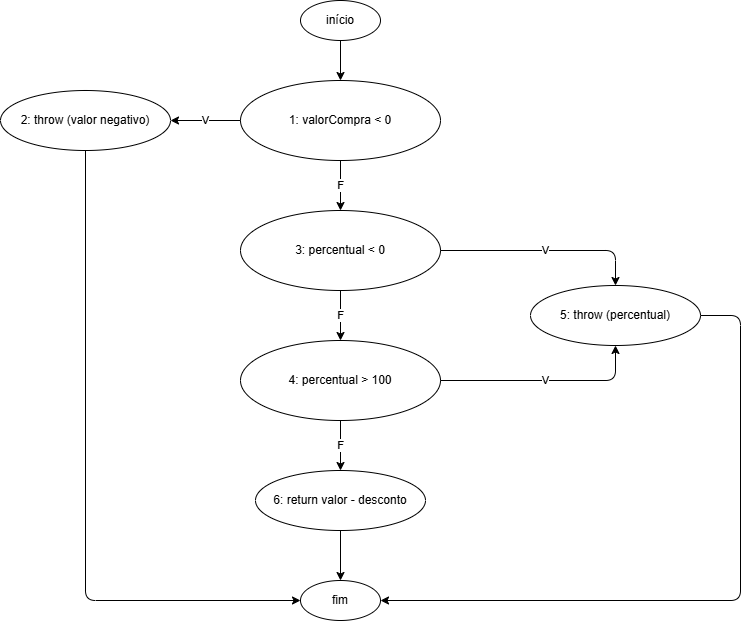
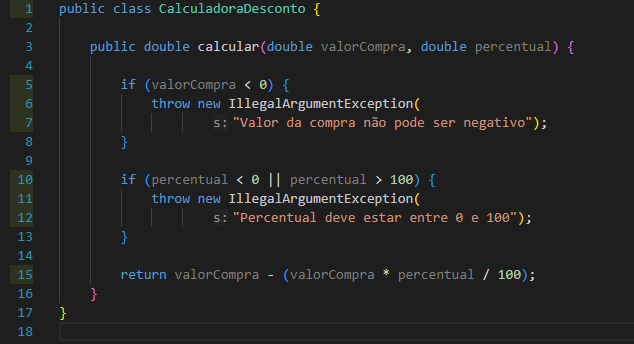
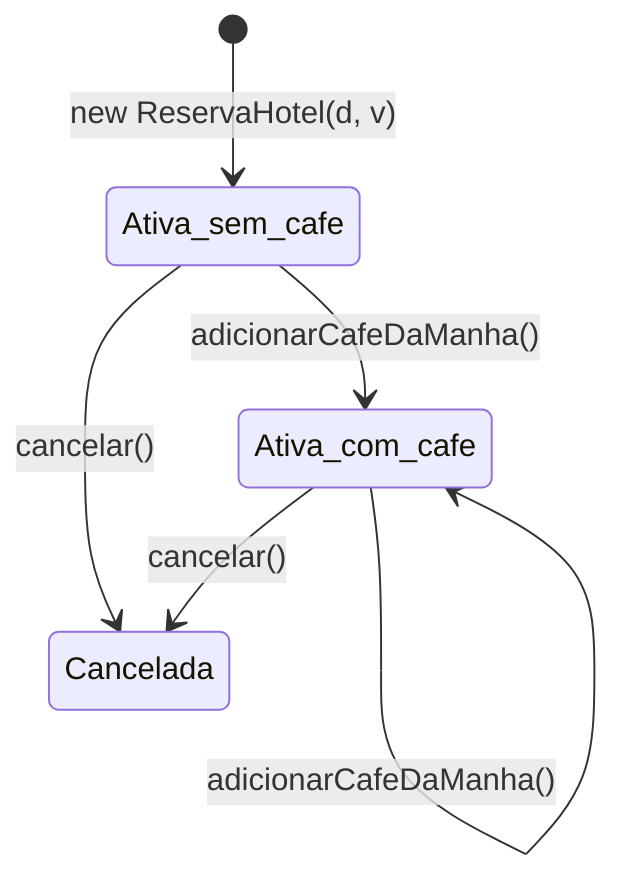
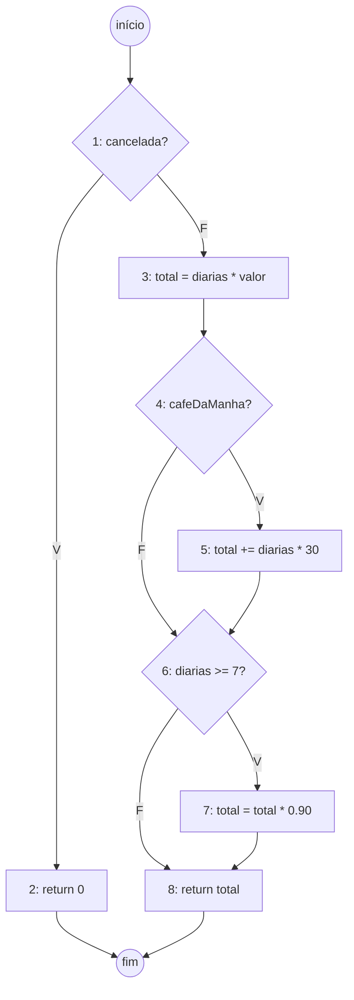

# Testes Unitários com JUnit - Relatório

## Critérios usados

Divisão: para cada classe usamos pelo menos um critério de cada lado.

- **Caixa-preta (funcional), parte da especificação:** partição de equivalência, valor-limite, estados / regras de negócio.
- **Caixa-branca (estrutural), parte do código:** ramos, condições, caminhos independentes e tratamento de erros.

Em cada teste no código tem um comentário dizendo de qual critério ele saiu. Nos valores-limite com `double` usamos 0,01 como passo, pensando em dinheiro (centavos). Os `assertEquals` com double usam uma margem de 0.0001 por causa do arredondamento.

---

## Exercício 1 - CalculadoraDesconto

### Partições de equivalência

| Variável | Classe | Intervalo | Exemplo |
|---|---|---|---|
| valorCompra | Inválida | < 0 | -500 |
| valorCompra | Válida | >= 0 | 200 |
| percentual | Inválida 1 | < 0 | -0,01 |
| percentual | Válida | 0 a 100 | 10 |
| percentual | Inválida 2 | > 100 | 100,01 |

### Valores-limite

| Fronteira | Logo abaixo | No limite | Logo acima |
|---|---|---|---|
| valorCompra = 0 | -0,01 (exceção) | 0 (ok) | 0,01 (ok) |
| percentual = 0 | -0,01 (exceção) | 0 (ok) | 0,01 (ok) |
| percentual = 100 | 99,99 (ok) | 100 (ok) | 100,01 (exceção) |

O 0 e o 100 têm que ser aceitos porque o código usa < e >.

### Grafo de Fluxo de Controle (GFC)

A condição `percentual < 0 || percentual > 100` foi separada em dois nós (3 e 4). Por causa do `||`, se a primeira for verdadeira a segunda nem passa.

- Nós: 8 (contando início e fim) | Arestas: 10
- Complexidade ciclomática: V(G) = E - N + 2 = 10 - 8 + 2 = **4** (ou 3 decisões + 1)

São 4 caminhos independentes. Como não tem laço, esses são todos os caminhos possíveis do método:

| Caminho | Sequência | Caso de teste |
|---|---|---|
| Caminho 1 | 1 → 2 | Casos 3 e 6 |
| Caminho 2 | 1 → 3 → 5 | Caso 4 |
| Caminho 3 | 1 → 3 → 4 → 5 | Caso 5 |
| Caminho 4 | 1 → 3 → 4 → 6 | Casos 1 e 2 |

**Condições:** cada lado do `||` foi verdadeiro pelo menos uma vez (caso 4: `percentual < 0`; caso 5: `percentual > 100`) e os dois foram falsos juntos no caso 1.

### Casos de teste

| Caso | Entrada (valor, %) | Esperado | Objetivo / critério |
|---|---|---|---|
| 1 | 200, 10 | 180 | partição válida / caminho 4 |
| 2 | (100,0) (100,0,01) (100,99,99) (100,100) (0,50) (0,01,0) | 100 / 99,99 / 0,01 / 0 / 0 / 0,01 | valor-limite (válidos) |
| 3 | (-0,01,10) (-500,10) | exceção do valor | partição inválida + limite / tratamento de erros / caminho 1 |
| 4 | 100, -0,01 | exceção do percentual | limite / condição 1 / caminho 2 |
| 5 | 100, 100,01 | exceção do percentual | limite / condição 2 / caminho 3 |
| 6 | -1, 150 | exceção do valor | dois inválidos juntos / caminho 1 |

O caso 6 com os dois valores inválidos, aparece a mensagem do valor.

### Cobertura obtida

Linhas: **100%** | Ramos: **100%**

### O conjunto é suficiente?

Para esse método achamos que sim. Ele não guarda estado e não tem laço, os 4 caminhos do GFC foram executados e os limites das duas variáveis foram testados dos dois lados.

Só pra cobrir os ramos bastavam 4 testes, um por caminho (casos 1, 3, 4 e 5). Os demais (o caso 2 e o caso 6) não aumentam a cobertura, mas são os que testam as fronteiras, onde costuma estar o erro.

Uma coisa que vimos no código e que a regra não trata: com `Double.NaN` no percentual, as duas comparações dão falso, o método não lança exceção e devolve `NaN`. Não fizemos teste disso porque o enunciado não diz o que deveria acontecer. Fica só a observação.

---

## Exercício 2 - ContaBancaria

### Partições e limites

| Operação | Válido | Inválido | Limite |
|---|---|---|---|
| Construtor | saldoInicial >= 0 | < 0 | 0 é válido |
| depositar | valor > 0 | <= 0 | 0 é inválido |
| sacar | 0 < valor <= saldo | <= 0 ou > saldo | 0 inválido, valor = saldo válido |

No construtor o 0 é aceito e no depósito/saque é rejeitado, por isso o 0 aparece em quase todos os testes de limite.

### Mudanças de estado verificadas

O único estado da classe é o `saldo`. Conferimos que:

- depósito válido aumenta o saldo no valor exato;
- saque válido diminui o saldo no valor exato;
- **operação que dá erro não mexe no saldo** (todo teste de exceção também confere o saldo depois);
- operações em sequência usam sempre o saldo atualizado (caso 14).

### Recursos do JUnit usados

- `@BeforeEach`: cria uma conta com 100 antes de cada teste, assim um teste não interfere no outro.
- `@ParameterizedTest` com `@ValueSource`: nos casos inválidos, onde só muda o valor de entrada e o resultado esperado é o mesmo.
- `assertThrows`: pega a exceção e permite conferir a mensagem.

### Casos de teste

| Caso | Entrada | Esperado | Objetivo / critério |
|---|---|---|---|
| 1 | new ContaBancaria(150) | saldo 150 | partição válida |
| 2 | new ContaBancaria(0) | saldo 0 | valor-limite / ramo falso |
| 3 | saldo -0,01 e -100 | exceção | partição inválida + limite / tratamento de erros |
| 4 | depositar 50 (saldo 100) | 150 | partição válida / estado / ramo falso |
| 5 | depositar 0,01 | 100,01 | valor-limite |
| 6 | depositar 0, -0,01, -50 | exceção, saldo 100 | limite + partição / tratamento de erros / estado |
| 7 | depositar 10, 20, 30 | 160 | estado |
| 8 | sacar 30 (saldo 100) | 70 | partição válida / os dois ifs falsos |
| 9 | sacar 100 (saldo 100) | 0 | valor-limite (valor = saldo) |
| 10 | sacar 0,01 | 99,99 | valor-limite |
| 11 | sacar 0, -0,01, -20 | exceção, saldo 100 | limite + partição / 1º if verdadeiro |
| 12 | sacar 100,01 e 500 | "Saldo insuficiente", saldo 100 | limite + partição / 2º if verdadeiro |
| 13 | conta com 0, sacar 0,01 | exceção, saldo 0 | valor-limite |
| 14 | 50 → +50 → -80 → tenta -20,01 → -20 | erro no 20,01, saldo final 0 | estado |

**Ramos:** a classe tem 4 `if` e cada um foi executado dando verdadeiro e falso. A coluna "objetivo" mostra quais casos fazem isso.

### Cobertura obtida

Linhas: **100%** | Ramos: **100%**

_(print da cobertura)_

### O conjunto é suficiente?

A cobertura de 100% já aparecia com uns 6 testes, um pra cada lado de cada `if`. Os outros não mudam a porcentagem, mas são os que pegam erro de verdade:

- **Caso 9 (sacar exatamente o saldo):** pega se alguém trocar `>` por `>=`. Sem ele a cobertura continua 100% e o erro passa.
- **Conferir o saldo nos testes de exceção:** pega o erro de "fez a conta antes de validar".
- **Caso 14:** pega se o método usasse o saldo inicial em vez do atual.

Ou seja, os casos a mais se justificam pelos valores-limite e pelo estado, e não pela cobertura. Ficou de fora depositar `Double.NaN` ou `Double.POSITIVE_INFINITY`, que passam pela validação. É a mesma observação do exercício 1.

---

## Exercício 3 - ReservaHotel

### Regras de negócio

- **R1:** número de diárias > 0 e valor da diária > 0 (no construtor)
- **R2:** café da manhã custa R$ 30 por diária
- **R3:** 7 diárias ou mais têm 10% de desconto. O desconto é aplicado depois do café, então o café também ganha desconto
- **R4:** reserva cancelada tem valor total 0
- **R5:** reserva cancelada não aceita café e não pode ser cancelada de novo

### Partições e limites

| Variável | Válido | Inválido | Limites testados |
|---|---|---|---|
| numeroDiarias | >= 1 | <= 0 | 0 e 1 |
| valorDiaria | > 0 | <= 0 | 0, -0,01 e 0,01 |
| numeroDiarias (desconto) | 1 a 6 sem desconto, >= 7 com desconto | - | 6 e 7 |
| cafeDaManha | com / sem | - | - |

### Estados da reserva

| Estado / Operação | adicionarCafeDaManha() | cancelar() | calcularValorTotal() |
|---|---|---|---|
| Ativa (sem café) | ok, passa pra com café (caso 11) | ok, vira cancelada (caso 8) | diárias × valor (caso 4) |
| Ativa (com café) | ok, sem efeito (caso 7) | ok, vira cancelada (caso 6) | com café (caso 4) |
| Cancelada | **exceção** (caso 10) | **exceção** (caso 9) | 0 (casos 5 e 6) |

### GFC de calcularValorTotal()

- Nós: 10 (com início e fim) | Arestas: 12
- V(G) = 12 - 10 + 2 = **4** (3 decisões + 1)

Pela complexidade bastariam 4 caminhos independentes. Mas os dois `if` do meio não dependem um do outro, então dá pra fazer as 4 combinações de café e desconto, mais o caminho da reserva cancelada. São 5 caminhos no total, todos possíveis, e testamos todos:

| Caminho | Sequência | Situação | Caso de teste |
|---|---|---|---|
| Caminho 1 | 1 → 2 | cancelada | Casos 5 e 6 |
| Caminho 2 | 1 → 3 → 4 → 6 → 8 | sem café, < 7 diárias | Caso 4 (6, sem café) |
| Caminho 3 | 1 → 3 → 4 → 5 → 6 → 8 | com café, < 7 diárias | Caso 4 (6, com café), (1, com café) |
| Caminho 4 | 1 → 3 → 4 → 6 → 7 → 8 | sem café, >= 7 diárias | Caso 4 (7, sem café), (10, sem café) |
| Caminho 5 | 1 → 3 → 4 → 5 → 6 → 7 → 8 | com café, >= 7 diárias | Caso 4 (7, com café) |

O caminho 5 era o que mais interessava, porque mostra que o desconto vale em cima do café também (7 × 130 = 910, menos 10% = 819). Se fosse só cobrir os ramos, o caminho 2 e o caminho 5 já davam 100%, e nunca teríamos testado café sem desconto e desconto sem café separados.

### Casos de teste

| Caso | Entrada | Esperado | Objetivo / critério |
|---|---|---|---|
| 1 | diárias 0 e -1 | exceção | partição inválida + limite / tratamento de erros |
| 2 | valor 0, -0,01, -100 | exceção | partição inválida + limite / tratamento de erros |
| 3 | (1, 0,01) | ativa, total 0,01 | valor-limite (mínimos válidos) |
| 4 | 6 combinações de diárias e café | 600, 780, 630, 819, 130, 900 | limite 6/7 + partições / caminhos 2 a 5 |
| 5 | cancelar e calcular | 0 | estado / caminho 1 |
| 6 | 8 diárias + café, cancelar, calcular | 0 | estado / caminho 1 |
| 7 | café 2x em 3 diárias de 100 | 390 (não cobra em dobro) | regra de negócio |
| 8 | cancelar reserva ativa | isCancelada = true | estado / ramo falso |
| 9 | cancelar 2x | exceção | estado / tratamento de erros |
| 10 | café em reserva cancelada | exceção, total continua 0 | estado / tratamento de erros |
| 11 | total antes e depois do café | 300 → 390 | estado / ramo falso |

Pra não repetir código, o caso 4 é um `@ParameterizedTest` com `@CsvSource` (um teste só passa pelos 4 caminhos do cálculo), e o `@BeforeEach` cria a reserva padrão dos testes de estado.

### Cobertura obtida

Linhas: **100%** | Ramos: **100%**

_(print da cobertura)_

### O conjunto é suficiente?

A cobertura deu 100%, mas nessa classe isso sozinho não quer dizer muito. Com uns 6 testes já dá 100% de ramos e mesmo assim ficaria de fora:

- o limite 6/7 do desconto (um `>= 7` virando `> 7` passaria);
- café sem desconto e desconto sem café, testados separados;
- reserva com café sendo cancelada, que também tem que dar 0.

Por isso montamos os testes a partir dos caminhos do GFC e da tabela de estados, e não da porcentagem.

O que não foi testado:

- não tem como "descancelar" a reserva nem tirar o café, então essas transições não existem;
- não existe getter pro café, então só dá pra ver que ele entrou pelo valor total;
- valores muito grandes e `NaN` no valor da diária. O `NaN` passa pela validação, igual nos outros exercícios.

---

## Resultado da execução

_(print dos testes passando na IDE)_

51 testes executados, 0 falhas: CalculadoraDescontoTest 12, ContaBancariaTest 20, ReservaHotelTest 19. Cada linha de um teste parametrizado conta como um teste separado, por isso o número é maior que a quantidade de casos.

## Conclusão

As três classes ficaram com 100% de cobertura de linhas e ramos. Mas, como foi visto em aula, cobertura alta não quer dizer que não tem defeito. Nos três exercícios a cobertura chegava em 100% bem antes de terminar os testes.

Os testes que mais fazem diferença saíram dos valores-limite (0, 100, sacar o saldo exato, 6/7 diárias) e da verificação de estado (saldo não muda quando dá erro, reserva cancelada). A parte estrutural (ramos, condições e o GFC) serviu pra conferir que nenhum caminho ficou sem teste.
